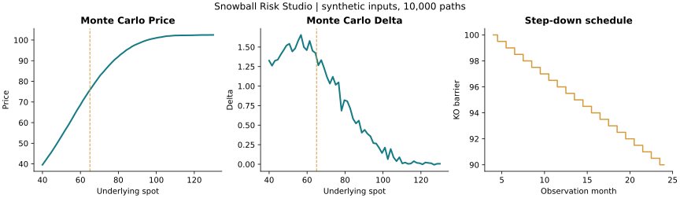
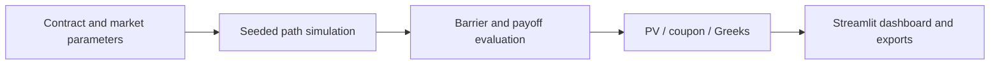

# Snowball Risk Studio

**From path simulation to an explorable structured-product risk surface.**

A Python valuation engine and Streamlit workstation for a step-down autocallable
with European knock-in. It connects Monte Carlo pricing, coupon calibration and
finite-difference risk measures in one interactive application.



## Capabilities

- Vectorized, chunked simulation under risk-neutral geometric Brownian motion.
- Present value and target coupon for a selected issue price.
- Delta, Gamma and price curves using common random numbers.
- Spot/time heatmaps and observation-date Delta jumps.
- Knock-out timing, terminal loss probabilities and random-seed stability.
- Downloadable CSV tables and a portable analysis ZIP.



## Run

```bash
python -m venv .venv
source .venv/bin/activate
pip install -r requirements.txt
streamlit run app.py
```

For the engine without the UI:

```python
from snowball_engine import SnowballParams, generate_normals, price_snowball
params = SnowballParams(n_sims=5000)
params.validate()
normals = generate_normals(params, seed=42)
pv = price_snowball(params.S0, 0.0, normals, params)
print(pv)
```

## Model boundaries

Monthly knock-out observations follow a lock-in period and a linear step-down
barrier. Knock-in is checked **only at maturity**. Rates, dividends and volatility
are deterministic. This is not a daily knock-in model. Results depend on the
simulation size and bump convention; no live-trading or external validation is
claimed. The figure uses synthetic contract and market inputs.

## Layout

`snowball_engine.py` contains numerical analytics; `app.py` contains the dashboard.
`examples/model_analytics.py` reproduces the figure. See [VALIDATION.md](VALIDATION.md)
and [PROVENANCE.md](PROVENANCE.md) for verification and source context.
